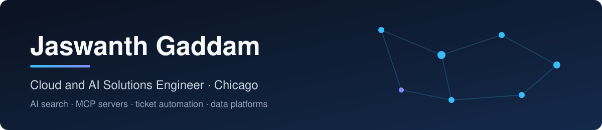
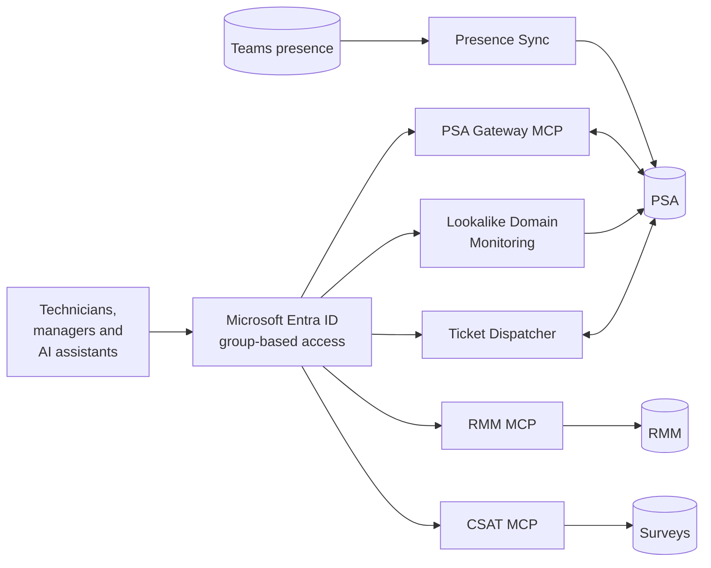

  
  
  

  
  
  
  
  
  
  
  

I build data platforms, MCP servers and automation that make messy operational reality answerable.

Most of my production work is in private repositories, so what is here is the part that travels: the architecture, the decisions and the failures, written up so they are useful to someone who will never see the code.

| ~70% | 90%+ | 100,000+ | 10 min |
|:---:|:---:|:---:|:---:|
| faster technician document lookup with a hybrid-retrieval RAG platform | AI agent first-try success on documentation queries, up from about 40% | tickets assigned automatically in six months | new-hire setup with n8n automation, down from 2 to 5 days |

Production systems on Azure: RAG search, MCP servers with per-call authorization, event-driven ticket automation and multi-source data platforms. Before that, data engineering: ETL pipelines processing 5M+ records a day with PySpark, PostgreSQL, Kafka and Tableau.

---

## Start here

**[client-intelligence-platform](https://github.com/Jaswanthnani02/client-intelligence-platform)**: architecture case study

A platform that continuously reconciles four disconnected operational systems into one queryable model and exposes it to an LLM as a set of authorized tools. Five decision records, each with the tradeoff and what I would reconsider. Five production failures and what each one changed.

The decision I would defend hardest: deleting a working, well-liked feature because a value stored apart from its inputs is a cache with no invalidation strategy. Scores are now composed at read time, where the inputs are visible next to the result.

---

## Production work

Built at a managed IT services provider. The code is private; each write-up covers the problem, the architecture with diagrams, the design decisions and my role. Client and environment details are left out.

| Project | What it does | Stack |
|---|---|---|
| **[Intelligent Ticket Dispatcher](projects/ticket-dispatcher.md)** | Assigns every service desk ticket within five minutes by availability and weighted load, with a dashboard that explains each decision | Azure Functions · Blob Storage · Entra ID |
| **[Lookalike Domain Monitoring](projects/lookalike-domain-monitoring.md)** | Finds domains built to impersonate an organization, scores the risk, and runs takedowns behind two human approvals | Container Apps · Cosmos DB · LLM triage |
| **[PSA API Gateway MCP Server](projects/psa-api-gateway-mcp.md)** | Lets an AI assistant find and call over a thousand PSA API endpoints in plain language | MCP · SQLite · Python |
| **[RMM Integration MCP Server](projects/rmm-mcp-server.md)** | Group-restricted, fully audited access to endpoint and device health | MCP · Key Vault · GitHub Actions |
| **[Customer Satisfaction MCP Server](projects/csat-mcp-server.md)** | CSAT and NPS data for AI assistants, with per-user sign-in and no shared keys | MCP · MSAL · Container Apps |
| **[Integration Map](projects/integration-map.md)** | Interactive map of 48 systems, 15 MCP servers and about 160 data flows | React 19 · Vite · SVG |
| **[Ticket Aging Reports](projects/ticket-aging-reports.md)** | Excel reports of stalled tickets with AI-written next steps | Azure OpenAI · Python |
| **[Presence to In/Out Sync](projects/presence-sync.md)** | Keeps the PSA availability board in step with Teams presence | Microsoft Graph · Python |

---

## Open source and demos

**[doc-link-check](https://github.com/Jaswanthnani02/doc-link-check)**: a tool that came out of the case study

Verifies that every relative link in a project's Markdown resolves. One file, no dependencies, no network. It exists because reorganizing a documentation tree quietly invalidated a dozen paths cited in source comments, where no test and no compiler knows a comment is a reference.

Relative links only, on purpose. External URL checking needs the network, gets rate-limited, and produces false failures until people ignore the results.

**[mcp-rbac-demo](https://github.com/Jaswanthnani02/mcp-rbac-demo)**: authorization for LLM tool servers

A tool server with API-key authentication and three permission tiers, against mock data. A runnable slice of the pattern in [decision 0005](https://github.com/Jaswanthnani02/client-intelligence-platform/blob/main/docs/decisions/0005-per-call-authorization.md) of the case study: authorize every call rather than every session. It implements the role axis; the client-scoping axis is described in the decision record.

**[ticket-dispatcher-demo](https://github.com/Jaswanthnani02/ticket-dispatcher-demo)**: assignment under load

Round-robin and weighted-load ticket assignment against a mock PSA API, the public companion to the [production dispatcher write-up](projects/ticket-dispatcher.md). Fake tickets and technicians throughout.

### Earlier projects

| Project | What it is |
|---|---|
| [call-auditor-app](https://github.com/Jaswanthnani02/call-auditor-app) | AI call quality auditor that analyzes customer-service calls for compliance issues and sentiment |
| [HR-Messages](https://github.com/Jaswanthnani02/HR-Messages) | Streamlit app that matches resumes to job descriptions and drafts personalized recruiter outreach |
| [worldmonitor](https://github.com/Jaswanthnani02/worldmonitor) | Extension of the open-source World Monitor dashboard: webcam hand-gesture and voice control for its AI analyst, plus Gemini support |
| [vs](https://github.com/Jaswanthnani02/vs) | Voice chatbot for visually impaired users: a Rasa assistant on AWS EC2 with a React Native app |
| [Resume_Classifier](https://github.com/Jaswanthnani02/Resume_Classifier) | Random forest resume classifier with a deployment script |

---

## What I care about

**Failures that are silent.** Four of the five production incidents I have written up produced no error at all: the system kept reporting success while doing less than it should. That changed how I monitor things more than any individual fix. Absence and staleness are better signals than errors, because a job that does not run cannot report that it failed.

**Invariants that execute.** A constraint in a comment is a hope. A constraint with a test behind it is a guarantee. The rules that broke in production were, without exception, the ones documented rather than asserted.

**Choosing the failure direction.** A permission that is forgotten should produce a tool nobody can call, not one everybody can call. Both are bugs; only one is discovered by an audit.

**AI as an advisor, not an actor.** Where a model touches production, it adds summaries and verdicts for a person to review. Anything that sends, deletes or assigns sits behind a dry-run mode, a kill switch or a human approval.

---

## Elsewhere

Currently building at a managed service provider: ingestion pipelines, a read-only query layer over them, MCP servers, and the authorization model that lets an LLM touch client data safely.

Based in Chicago. Happy to talk about any of the above on [LinkedIn](https://www.linkedin.com/in/gaddamjaswanth/).
