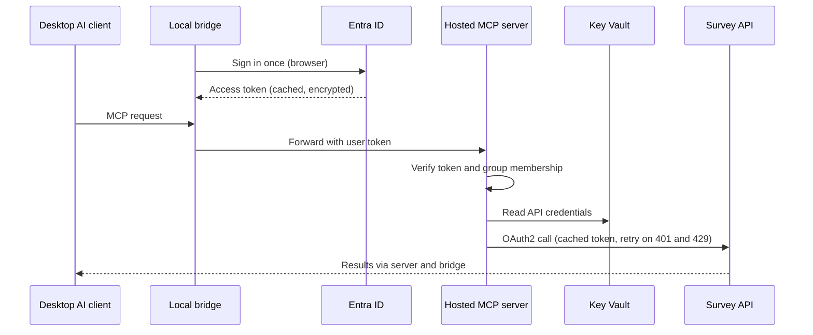

# Customer Satisfaction MCP Server

[Back to profile](../README.md)

## The problem

Customer satisfaction (CSAT) and Net Promoter Score (NPS) feedback sits in a separate survey platform. Account managers want to ask questions about it without exporting spreadsheets, and the API credentials should never sit on individual laptops.

## What I built

An async MCP server that covers every read endpoint of the SmileBack v3 data replication API: CSAT reviews, NPS campaigns and responses, project surveys, agents, boards and contacts, across 12 tools.

## How it works

- **OAuth2 token handling.** Tokens are cached, refreshed automatically on 401 responses, and requests retry with backoff on 429 rate limits.
- **Bounded pagination.** List tools fetch pages automatically up to a record cap and report when results were truncated, so the assistant knows to narrow its filters.
- **Incremental sync.** Supports modified-since and created-since watermarks.

## Per-user cloud access without shared secrets

The server runs on Azure Container Apps. A small local bridge signs each user in with Microsoft Entra ID and forwards their token, so no API credentials or shared keys sit on the user's machine. Access is limited to one Entra group, and removing someone from the group blocks them immediately, with no key rotation needed.

## Stack

Python 3.11, MCP (stdio and Streamable HTTP), async HTTP, Microsoft Entra ID with MSAL, Azure Container Apps, Key Vault, PowerShell installer.

## My role

Sole developer.
