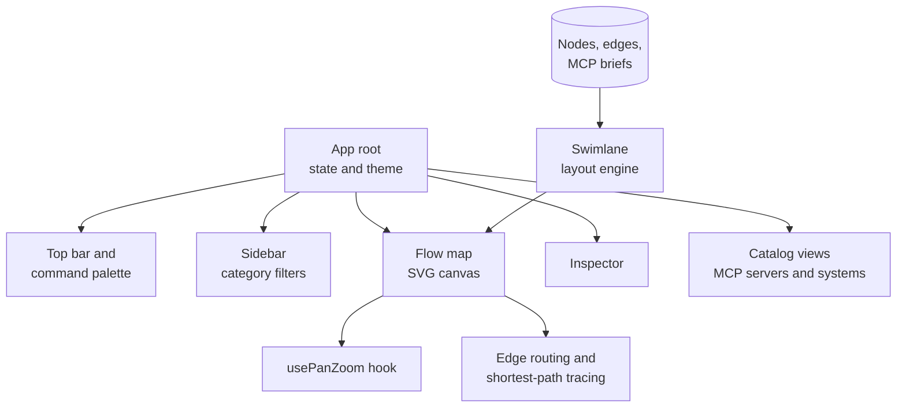

# Integration Map

[Back to profile](../README.md)

## The problem

A modern MSP runs dozens of tools, including PSA, RMM, documentation, backup, security, identity and billing, plus a growing set of AI integrations. Nobody could see the whole picture, which made it hard to judge the impact of a change or explain to leadership where AI touches the data.

## What I built

An interactive map of about 48 systems and 15 MCP servers, arranged in swimlanes (identity, applications, systems of record, MCP servers, AI) with roughly 160 data flows.

## Features

- Pan, zoom at the cursor, fit to screen, a minimap and draggable nodes.
- **Neighborhood focus.** Selecting a system zooms to it and its connections, with inbound and outbound flows colored separately.
- **Path tracing.** Shift-click two systems to highlight the shortest data path between them.
- **Inspector.** Shows each system's role and connections. For MCP servers it also shows status, the split between read and write tools, guardrails and the full tool list.
- A sortable, filterable systems table, a command palette (Ctrl/Cmd+K), category filters, and light and dark themes.

## Component structure

## Technical notes

- React 19 and Vite 7, with no state library, router or TypeScript, which keeps the bundle small and the code easy to follow.
- Pure SVG rendering with a custom swimlane layout engine, edge routing and text fitting.
- Deployed as a static single-page app on Azure App Service.

## My role

Sole designer and developer.
