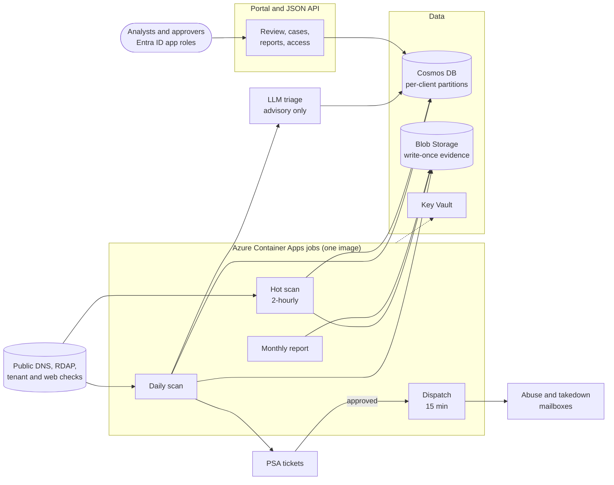
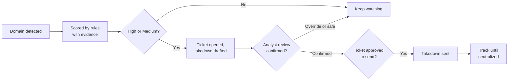

# Lookalike Domain Monitoring Platform

[Back to profile](../README.md)

## The problem

Attackers register domains that look like an organization's real domain, such as a swapped letter or an extra hyphen, then use them for invoice fraud and credential phishing. These domains are cheap to register and easy to miss until the money is gone.

## What I built

A managed security service that finds lookalike domains, scores how likely each one is to be used for impersonation, opens service tickets for analysts and sends takedown reports, but only after people approve them.

## How it works

Several scheduled jobs and a web portal all run from one container image:

| Job | Cadence | Purpose |
|---|---|---|
| Scan | Daily | Generates domain permutations; runs DNS, RDAP registration, Microsoft 365 tenant and website checks; scores and compares the results; stores the evidence |
| Hot scan | Every 2 hours | Rechecks only known registered lookalikes, so a new mail record or takedown shows up within hours |
| Dispatch | Every 15 minutes | Sends prepared abuse reports for cases an analyst has approved |
| Report | Monthly | Produces a PDF report per organization for review |
| Portal | Always on | Review queue, evidence, case management, reports and access administration |

### Architecture

### Finding lifecycle

**Explainable scoring.** Each finding's review page shows every scoring rule checked in order, with the question, the answer and the evidence, and highlights the rule that decided the rating. A methodology page is generated from the same constants the scanner uses, so the documentation cannot drift from production.

**AI-assisted triage.** A language model adds a short verdict and summary to each registered lookalike, using public DNS and registration data only. It is advisory: it cannot change a rating, send anything or close a case. A second model can run in shadow mode so the two can be compared on the same evidence before any switch.

## Guardrails

| Guardrail | How it works |
|---|---|
| Two human approvals | A confirmed portal review and an approved service ticket are both required before anything is sent |
| Kill switch and caps | Sending is off by default, with a daily send cap and a test-redirect mode |
| No duplicate sends | Idempotency keys, claim-before-send and stale-claim sweeps |
| Tenant isolation | Data is partitioned per organization, every route is authorized, and records a user cannot see return the same 404 as missing ones |
| Least privilege | Separate managed identities, with Key Vault, storage and database access scoped per resource |
| Audit | Write-once evidence and a hash-chained audit log |
| Two-person onboarding | One admin requests onboarding with signed authorization, and a second person must confirm it |

## Stack

Python, Azure Container Apps (jobs and web app), Azure Cosmos DB, Blob Storage, Key Vault, Microsoft Entra ID with app roles and group-based access, headless Chromium for PDF rendering, LLM integration through Microsoft Foundry, Azure Pipelines with dependency audit, container scanning and SBOM generation.

## Results

- Tracks time to detect, time to report and time to takedown, with median and p90 shown in the portal.
- More than 1,000 automated tests, including tests for client isolation and duplicate-send prevention.
- Security controls are mapped to SOC 2.

## My role

Lead developer: architecture, scanner and scoring engine, portal and API, guardrails, and deployment pipeline.
