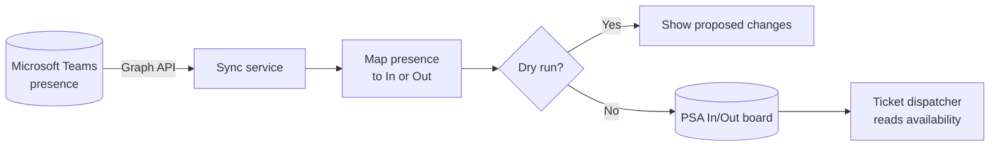

# Presence to In/Out Board Sync

[Back to profile](../README.md)

## The problem

The PSA's In/Out board, which dispatch relies on to know who is available, depended on technicians updating it by hand. It was often wrong, and tickets went to people who were away.

## What I built

A sync service that reads Microsoft Teams presence through Microsoft Graph and updates the ConnectWise In/Out board to match.

| Teams presence | In/Out status |
|---|---|
| Available, Busy, Do Not Disturb | In |
| Away, Be Right Back, Offline | Out |

## Flow

## Design notes

- **Dry run by default.** Live updates need an explicit setting, and a demo mode shows a table of the changes it would make.
- Diagnostic utilities show Teams presence and the In/Out board side by side for troubleshooting.
- Gives the ticket dispatcher accurate availability data.

## Stack

Python, Microsoft Graph API, ConnectWise Manage API, Azure.

## My role

Sole developer.
