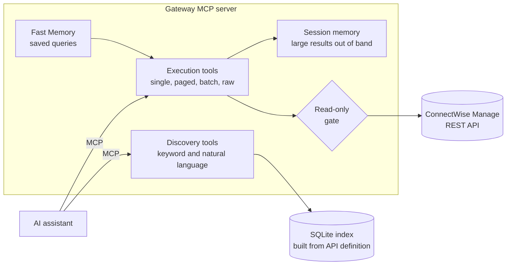

# PSA API Gateway MCP Server

[Back to profile](../README.md)

## The problem

ConnectWise Manage exposes well over a thousand REST endpoints. Finding the right one, building correct filter syntax and paging through results is slow for people and error-prone for AI assistants.

## What I built

A Model Context Protocol (MCP) server that lets an AI assistant discover and call the ConnectWise Manage API in plain language.

## How it works

- **Database-backed discovery.** The official API definition is compiled into a SQLite index, so endpoint lookups are fast and run offline.
- **Natural-language search.** The server maps a description such as "open tickets for a company" to the right endpoints and parameters, using domain synonyms.
- **Category browsing and endpoint detail.** Parameters, schemas and response formats are available on demand.
- **Execution tools.** Single calls, auto-paginated calls, concurrent batches, and a raw-request escape hatch for full control.
- **Fast Memory.** Saves frequently used queries so repeat work skips discovery, and tracks which calls are most valuable.
- **Session memory.** Large result sets are stored out of band and can be filtered and aggregated without fetching them again, which keeps the assistant's context small.
- **Read-only mode.** Writes are blocked unless explicitly enabled.

## Architecture

## Stack

Python 3.10+, MCP, SQLite, Node.js launcher for Claude Desktop, Docker, Azure deployment option.

## Results

- Lets AI assistants answer PSA questions that previously needed someone who knew the API.
- Includes load, stress and read-only-mode test suites.

## My role

Sole developer: discovery index, search, execution layer, memory systems and packaging.
