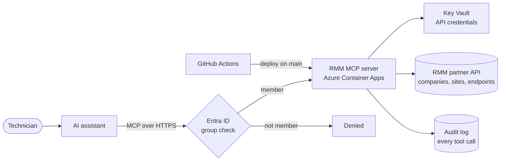

# RMM Integration MCP Server

[Back to profile](../README.md)

## The problem

Technicians and AI assistants need fast answers about managed endpoints: which devices are unhealthy, which sites are affected, what changed. RMM data is sensitive, though, so access has to be controlled and every query has to be accountable.

## What I built

An MCP server for the ConnectWise Asio partner API. It lets an AI assistant list companies, sites, endpoints, device groups and health telemetry.

## Security design

- **Group-restricted access.** Only members of one Microsoft Entra ID security group can use the hosted server.
- **No secrets in code or config.** Every credential lives in Azure Key Vault.
- **Full audit trail.** Every tool call is logged.
- **Two transports.** stdio for local desktop clients, and HTTP for the hosted deployment.

## Architecture

## Delivery

- A push to the main branch deploys to Azure Container Apps through GitHub Actions, with a documented rollback procedure.
- Linting and format checks gate every change.
- More than 400 automated tests.

## Stack

Python, MCP, Azure Container Apps, Azure Key Vault, Microsoft Entra ID, GitHub Actions, Docker, pytest, Ruff.

## My role

Sole developer: server, security model, CI/CD and documentation.
