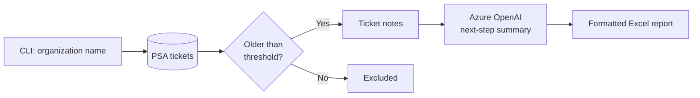

# Ticket Aging Report Generator

[Back to profile](../README.md)

## The problem

Account managers needed a quick view of which tickets for an organization had stalled, and what should happen next, without reading every ticket's note history.

## What I built

A command-line tool that pulls an organization's tickets from the PSA, keeps those older than a set age, and uses Azure OpenAI to write a "next steps" summary from each ticket's notes. The output is a formatted Excel report with the ticket ID, AI summary, age, description, assigned resources, contact and timestamps.

## Flow

## Design notes

- Degrades cleanly: if AI credentials are missing, the report still builds and marks summaries as unavailable.
- The age threshold keeps the report focused on tickets that actually need attention.

## Stack

Python, ConnectWise Manage API, Azure OpenAI, Excel export.

## My role

Sole developer.
