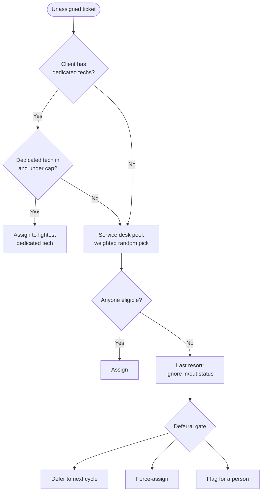
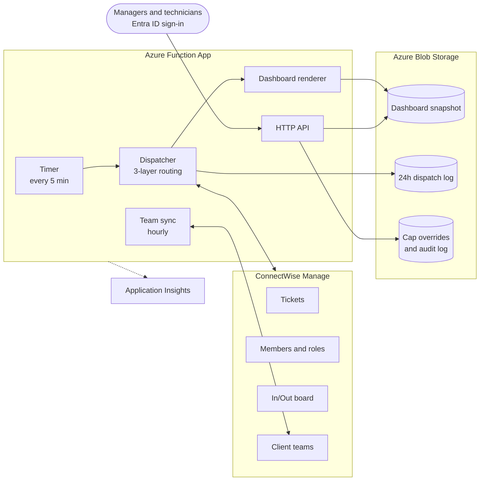
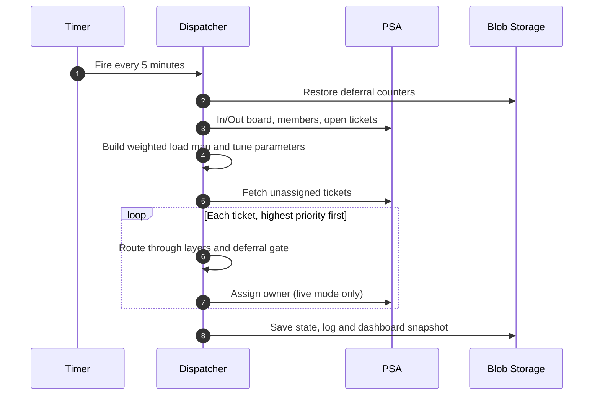

# Intelligent Ticket Dispatcher

[Back to profile](../README.md)

## The problem

A managed services desk receives a steady stream of tickets. Assigning them by hand is slow, uneven and hard to audit. Some technicians end up buried while others sit idle, and urgent tickets can wait in the queue for a person to notice them.

## What I built

A serverless dispatcher that runs every five minutes. It reads the PSA (ConnectWise Manage) queue, works out who is available and how loaded they are, and assigns each unassigned ticket to the right technician. A live dashboard shows every technician's workload and every decision the dispatcher made, with the reasoning behind it.

## How it works

Each cycle builds a weighted load map of every technician, then processes unassigned tickets with the highest priority first and the oldest first within each priority. Each ticket passes through up to three layers:

1. **Dedicated technicians.** If a client has assigned technicians, the one with the lightest high-priority load gets the ticket, as long as they are in and under their cap.
2. **Service desk pool.** A weighted random pick that favors lighter loads without letting one person collect every tied ticket.
3. **Last resort.** Ignores in/out status rather than leaving a ticket unowned.

A deferral gate decides whether a ticket should wait one cycle instead of piling onto someone who has already taken their share. Each priority has its own patience, and a ticket that ages out is force-assigned. A ticket is flagged for a person only when nobody at all can take it.

**Load is weighted, not counted.** A critical ticket counts more than a low-priority one, so someone with ten minor tickets is treated as less busy than someone with five outages.

**Self-tuning.** The per-cycle cap, spillover threshold and deferral limits are recalculated each cycle from batch size and staff availability, with no extra API calls.

## Architecture

### One dispatch cycle

## Design decisions

- **Fail safe, not fail empty.** Every read that feeds a write uses strict error handling, so a failed API call is never mistaken for "no data". A circuit breaker pauses requests after repeated failures, and retries back off exponentially.
- **Prove it before it acts.** Dry-run mode proposes assignments without writing them. The backlog rebalancer ships observe-only and logs what it would move until it is explicitly enabled.
- **Identity over secrets.** The dashboard and every manager control sit behind Microsoft Entra ID sign-in, and the audit log records the verified identity, never a typed name.
- **No database to run.** State lives in a few small JSON documents in Blob Storage. SQLite was rejected because the Functions Consumption plan's disk is ephemeral and not shared between instances.
- **Fast dashboard.** The dashboard renders once per cycle and is cached, so a page load takes well under a second.

## Stack

Python 3.11, Azure Functions (timer and HTTP triggers), Azure Blob Storage, Microsoft Entra ID (App Service Authentication), Application Insights, ConnectWise Manage REST API.

## Results

- Runs unattended every five minutes in production.
- Managers adjust caps and board selection from the dashboard, and every change is audited.
- Covered by a large mock-driven scenario test suite with more than 1,800 test cases.

## My role

Sole designer and developer: routing algorithm, Azure architecture, dashboard, tests and deployment.
